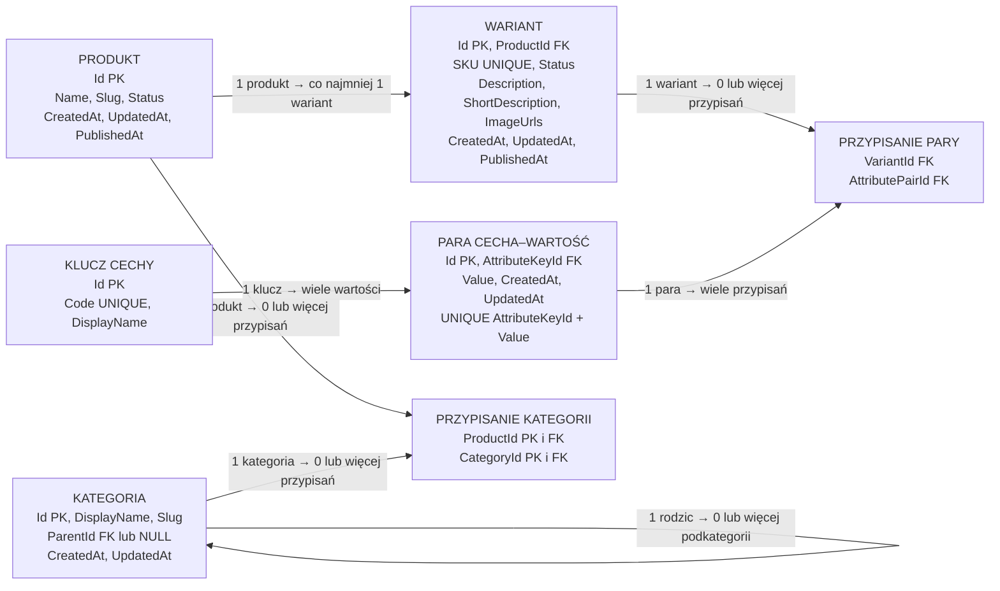

# Wstępny model katalogu

Cel: zebrać decyzje dotyczące produktu, wariantu, cech i kategorii oraz pokazać planowane relacje przed implementacją. Kolejność prac i statusy są w [planie backendu](project-direction.md).

## Stan potwierdzony w kodzie

Produkt, wariant, kategoria i ich cechy nie mają jeszcze encji, tabel ani migracji. Poniższy model jest projektem, nie opisem istniejącego schematu. Zgodnie z [zasadami bazy](database.md) przyszłe tabele aplikacji będą jawnie mapowane do schematu `app`.

## Ustalenia koncepcyjne

Źródło: decyzje właściciela projektu z 21 października 2026 r. Wybór pól i reguł jest wstępny; otwarte kwestie opisano niżej.

### Produkt

| Pole | Roboczy typ | Znaczenie |
| --- | --- | --- |
| `Id` | `Guid` | Stały identyfikator produktu. |
| `Name` | `string` | Wymagana nazwa. |
| `Slug` | `string` | Czytelna część adresu produktu. |
| `Status` | `Draft` / `Published` / `Hidden` | Stan całego produktu; ma pierwszeństwo przed statusem wariantów. |
| `CreatedAt` | data i czas UTC | Moment utworzenia produktu. |
| `UpdatedAt` | data i czas UTC | Moment ostatniej zmiany produktu. |
| `PublishedAt` | data i czas UTC lub `null` | Moment publikacji. |

Produkt nie przechowuje opisu, krótkiego opisu ani zdjęć. **Każdy zapisany produkt, także szkic i produkt w jednej konfiguracji, ma co najmniej jeden wariant.** W jednym produkcie może być wiele wariantów. Szkic produktu może nie mieć kategorii, ale przed publikacją trzeba przypisać go do co najmniej jednej kategorii.

### Wariant

| Pole | Roboczy typ | Znaczenie |
| --- | --- | --- |
| `Id` | `Guid` | Własny identyfikator wariantu. |
| `ProductId` | `Guid` | Wymagane powiązanie z jednym produktem. |
| `SKU` | `string` | Wymagane i unikalne w całym sklepie. |
| `Status` | `Draft` / `Published` / `Hidden` | Stan pojedynczego wariantu. |
| `Description` | `string?` | Pełny opis wariantu. |
| `ShortDescription` | `string?` | Krótki opis wariantu. |
| `ImageUrls` | lista adresów URL | Zdjęcia wariantu; sposób fizycznego zapisu jest otwarty. |
| `CreatedAt` | data i czas UTC | Moment utworzenia wariantu. |
| `UpdatedAt` | data i czas UTC | Moment ostatniej zmiany wariantu. |
| `PublishedAt` | data i czas UTC lub `null` | Moment publikacji wariantu; zachowanie przy ponownej publikacji pozostaje do ustalenia. |

Produkt dostępny tylko w jednej konfiguracji również ma jeden wariant. Wariant może mieć pusty zestaw cech; dwa warianty **tego samego produktu** nie mogą mieć identycznego zestawu przypisanych par cecha–wartość, także gdy oba zestawy są puste. Kolejność par nie ma znaczenia.

**Status produktu ma pierwszeństwo przed statusem wariantu.** `Draft` oznacza przygotowywanie oferty, `Published` pozwala ją pokazać, a `Hidden` celowo ją ukrywa. Wariant jest widoczny tylko wtedy, gdy **zarówno produkt, jak i wariant mają status `Published`**. Ustawienie produktu na `Hidden` ukrywa cały produkt i wszystkie jego warianty bez zmiany ich własnych statusów; nie wolno wtedy kupić żadnego z nich. Produkt w statusie `Draft` również nie jest widoczny ani dostępny do zakupu. Produkt może być `Published` tylko wtedy, gdy ma co najmniej jeden wariant `Published`.

Wariant bez ceny może pozostać `Draft`, ale przed zmianą na `Published` musi mieć bieżącą cenę. Wariant `Hidden` lub `Draft` nie jest widoczny ani dostępny do zakupu, nawet gdy produkt jest `Published`. Dalsze warunki zakupu, w tym znany stan magazynowy, są w [modelu magazynu](inventory-model.md) i [modelu cen](pricing-model.md).

### Klucze, wartości i przypisania

| Planowana tabela `app` | Pola i ograniczenia | Rola |
| --- | --- | --- |
| `attribute_keys` | `id uuid` PK; `code` UNIQUE; `display_name` | Wspólny słownik kluczy cech. `code=kolor` to kod techniczny, `display_name=Kolor` to **nazwa wyświetlana klucza**. |
| `attribute_pairs` | `id uuid` PK; `attribute_key_id uuid` FK; `value`; `created_at`, `updated_at`; UNIQUE (`attribute_key_id`, `value`) | Wspólny słownik par, np. `kolor=czerwony`. Daty dotyczą pary, a nie jej przypisania do wariantu. |
| `variant_attribute_pairs` | `variant_id uuid` FK; `attribute_pair_id uuid` FK; PK (`variant_id`, `attribute_pair_id`) | Przypisanie istniejącej pary do wariantu. |

Jeden wariant może mieć kilka **różnych** wartości tego samego klucza. Nie zakładamy ogólnego limitu jednej wartości; później backend może ograniczać to dla wybranych cech. Tę samą parę zapisujemy w słowniku raz i współdzielimy między wariantami.

Backend przycina białe znaki na początku i końcu `code` oraz sprowadza litery do małych przed wyszukaniem i zapisem. `Kolor`, `kolor ` i `kolor` wskazują ten sam klucz. `display_name` nie służy do sprawdzania unikalności. Sposób porównywania **wartości** pozostaje otwarty.

### Kategorie

Produkt może należeć do **wielu kategorii**. Kategorie tworzą drzewo o dowolnej głębokości, np. `Odzież → Damska → Koszulki`. Kategoria główna nie ma rodzica; podkategoria wskazuje jedną kategorię nadrzędną. **Nie wolno usunąć kategorii, która ma podkategorie.** Źródło: decyzje właściciela projektu z 21 października 2026 r.

**Nie wolno też usunąć kategorii, do której przypisano produkty.** Najpierw trzeba przenieść lub usunąć przypisania, zachowując regułę co najmniej jednej kategorii dla każdego opublikowanego produktu. Szkic produktu może nie mieć kategorii; produkt w statusie `Published` musi mieć przynajmniej jedną. Źródło: decyzja właściciela projektu z 22 października 2026 r.

Przy pobieraniu produktów z kategorii uwzględniamy produkty przypisane **bezpośrednio do niej oraz do wszystkich jej podkategorii**, niezależnie od głębokości drzewa. Przykład: zapytanie o kategorię `Mężczyzna` obejmuje także produkty przypisane do `Mężczyzna → T-shirt` i `Mężczyzna → T-shirt → T-shirty bez rękawa`. Przypisania w `product_categories` pozostają bezpośrednie; nie trzeba dopisywać produktu do każdego przodka. Produkt przypisany do kilku pasujących kategorii występuje w wyniku tylko raz. Źródło: decyzja właściciela projektu z 22 października 2026 r.

| Planowana tabela `app` | Robocze pola | Rola |
| --- | --- | --- |
| `categories` | `id uuid` PK; `display_name`; `slug`; `parent_id uuid` NULL FK → `categories.id`; `created_at`, `updated_at` (UTC) | Węzeł drzewa kategorii; `display_name` to nazwa widoczna dla użytkownika, a `parent_id = NULL` oznacza kategorię główną. `slug` jest unikalny wśród kategorii mających tego samego rodzica, również wśród kategorii głównych. |
| `product_categories` | `product_id uuid` FK → `products.id`; `category_id uuid` FK → `categories.id`; PK (`product_id`, `category_id`) | Przypisanie produktu do kategorii bez duplikowania tej samej pary. |

`DisplayName` jest wymagane: po przycięciu białych znaków na brzegach ma mieć od 1 do 120 znaków. `Slug` jest wymagany i przy tworzeniu kategorii powstaje z nazwy, np. `T-shirty bez rękawa` → `t-shirty-bez-rekawa`; administrator może go poprawić przed zapisem. Zmiana `DisplayName` później **nie zmienia automatycznie** istniejącego `Slug`. Zapisany `Slug` wolno zmienić ręcznie, jeśli nowa wartość spełnia format oraz jest wolna wśród kategorii z tym samym rodzicem (także wśród kategorii głównych). Dokładny format i maksymalną długość ustalimy przy implementacji. Przy konflikcie zapis ma zostać odrzucony. `CreatedAt` i `UpdatedAt` zapisujemy w UTC.

Można przenieść kategorię przez zmianę `ParentId`, jeśli nowy rodzic nie jest nią samą ani jej potomkiem i jej `Slug` jest wolny w nowym miejscu. Przeniesienie nie może utworzyć cyklu. Reguły walidujemy również przy równoczesnych zapisach. Źródło: zaakceptowane propozycje właściciela projektu z 22 października 2026 r.

Ścieżkę kategorii pokazujemy od korzenia do wybranego węzła, np. `Mężczyzna → T-shirt → T-shirty bez rękawa`. Kolejność kategorii mających tego samego rodzica oraz format publicznego adresu kategorii ustalimy przy projektowaniu widoku. Jeśli adres będzie zawierał `Slug` kategorii lub ścieżkę przodków, ręczna zmiana `Slug` albo przeniesienie kategorii może zmienić ten adres; wtedy trzeba zaprojektować przekierowanie ze starego adresu. Szczegóły przekierowania pozostają otwarte. Obecny model koncepcyjny kategorii wystarcza do przejścia do dalszych prac; pozostałe kwestie mają wskazane etapy rozstrzygnięcia.

#### Proponowany sposób egzekwowania reguł drzewa w PostgreSQL

- Dwa unikalne indeksy częściowe zabezpieczają `Slug`: osobny dla kategorii głównych (`parent_id IS NULL`) i osobny dla podkategorii (`parent_id IS NOT NULL`, para `parent_id` + `slug`). Dzięki temu równoczesne zapisy nie ominą unikalności wśród kategorii głównych, gdzie zwykły indeks na `(parent_id, slug)` nie wystarcza z powodu `NULL`. Szczegóły indeksów trzeba dostosować do ostatecznej normalizacji `Slug`. [Dokumentacja PostgreSQL: indeksy częściowe](https://www.postgresql.org/docs/current/indexes-partial.html).
- Klucz obcy `parent_id` wskazuje istniejącą kategorię; ograniczenie `CHECK` blokuje `parent_id = id`. Usuwanie rodzica z podkategoriami blokuje relacja w bazie. Sam `CHECK` nie wykryje dłuższego cyklu.
- Każde przeniesienie kategorii przebiega w transakcji `READ COMMITTED`: backend najpierw osobnym poleceniem bierze wspólną dla zmian drzewa blokadę transakcyjną, następnie zapytaniem rekurencyjnym sprawdza, czy nowy rodzic nie jest potomkiem przenoszonej kategorii, i dopiero potem aktualizuje `parent_id`. Wszystkie zapisy zmieniające `parent_id` muszą korzystać z tej samej ścieżki. Blokada serializuje równoczesne przeniesienia, a odczyt po jej uzyskaniu widzi zmiany zatwierdzone przez poprzednią transakcję. [Dokumentacja PostgreSQL: blokady transakcyjne](https://www.postgresql.org/docs/current/explicit-locking.html), [izolacja transakcji](https://www.postgresql.org/docs/current/transaction-iso.html), [zapytania rekurencyjne](https://www.postgresql.org/docs/current/queries-with.html).

To projekt techniczny do wdrożenia i przetestowania na rzeczywistej bazie, nie istniejące ograniczenia. Przed migracją trzeba ustalić sposób zamknięcia innych ścieżek zapisu `parent_id`, aby nie omijały kontroli cyklu, oraz przetestować równoczesne przeniesienia i zapisy `Slug`.

### Schemat relacji

Przykład: produkt `Koszulka` ma wariant `SKU-RED-S` z parami `kolor=czerwony` i `rozmiar=S`. Produkt z wariantami `czerwony/S` i `niebieski/M` nie spełnia filtra `czerwony + M`: wszystkie warunki muszą pasować do **tego samego wariantu**. Możliwość filtrowania po dowolnej udostępnionej cesze jest wymaganiem katalogu.

## Reguły spójności do wdrożenia

- `product_variants.product_id` jest wymaganym kluczem obcym do `products.id`. Sam klucz obcy nie zapewnia, że produkt ma wariant. Produkt i pierwszy wariant trzeba tworzyć atomowo; usunięcie ostatniego wariantu ma być zablokowane również w bazie, z uwzględnieniem równoczesnych zapisów.
- SKU ma być obowiązkowe i unikalne w całym sklepie. `attribute_keys.code` oraz para (`attribute_key_id`, `value`) mają ograniczenia UNIQUE. Backend używa istniejących wpisów, a baza chroni przed duplikatami przy równoczesnym zapisie.
- Przy utworzeniu wariantu lub zmianie jego przypisań należy pilnować, że żaden inny wariant **tego produktu** nie ma identycznego zbioru par. Mechanizm odporny na równoczesne zapisy wymaga osobnego projektu.
- `variant_attribute_pairs` nie może zawierać dwa razy tej samej pary dla jednego wariantu. Ten sam klucz może jednak występować z kilkoma różnymi wartościami.
- `categories.parent_id` wskazuje kategorię nadrzędną; usunięcie rodzica z podkategoriami musi być zablokowane także przy równoczesnych zapisach. Przeniesienie kategorii nie może utworzyć cyklu ani powiązać jej z samą sobą; wymaga też wolnego `slug` wśród nowego rodzeństwa. `product_categories` nie może zawierać dwa razy tej samej pary produktu i kategorii.
- Kategorii z przypisanymi produktami nie wolno usunąć. Opublikowany produkt musi zachować co najmniej jedno przypisanie także podczas usuwania lub przenoszenia przypisań; przed zmianą statusu na `Published` backend sprawdza ten warunek. `categories.slug` musi być unikalny wśród rodzeństwa, w tym korzeni drzewa.

## Pytania otwarte przed migracją

- Limity tekstów, unikalność i zmiana `Slug`, nadawanie `Id`, dozwolone przejścia między statusami oraz znaczenie `PublishedAt` przy ukryciu i ponownej publikacji produktu lub wariantu.
- Format i normalizacja SKU oraz szczegóły normalizacji `code`, w tym obsługa białych znaków i wielkości liter.
- Typy wartości cech, ich jednostki, normalizacja i porównywanie; ewentualne ograniczenia liczby wartości konkretnych kluczy.
- Fizyczny zapis i kolejność `ImageUrls`, w tym adresy URL lub ścieżki w Storage.
- Egzekwowanie minimum jednego wariantu i unikalnego zbioru par przy równoczesnych zapisach.
- Czy cechy wspólne mają istnieć także na poziomie produktu i jakie jest ich pierwszeństwo wobec cech wariantu.
- Dokładny format, normalizacja i maksymalna długość `Slug` przy implementacji; dostosowanie indeksów i walidacji do tego formatu; zamknięcie ścieżek zapisu omijających kontrolę cyklu oraz testy równoczesnych zmian.
- Przy projektowaniu widoku: format publicznych adresów kategorii, ewentualne przekierowania oraz kolejność kategorii mających tego samego rodzica.
- Model promocji nie jest częścią obecnych tabel katalogu. Wstępne powiązanie stanu z wariantem jest w [modelu magazynu](inventory-model.md), a cena wariantu i uzgodniona koncepcja jej historii w [modelu cen](pricing-model.md).
