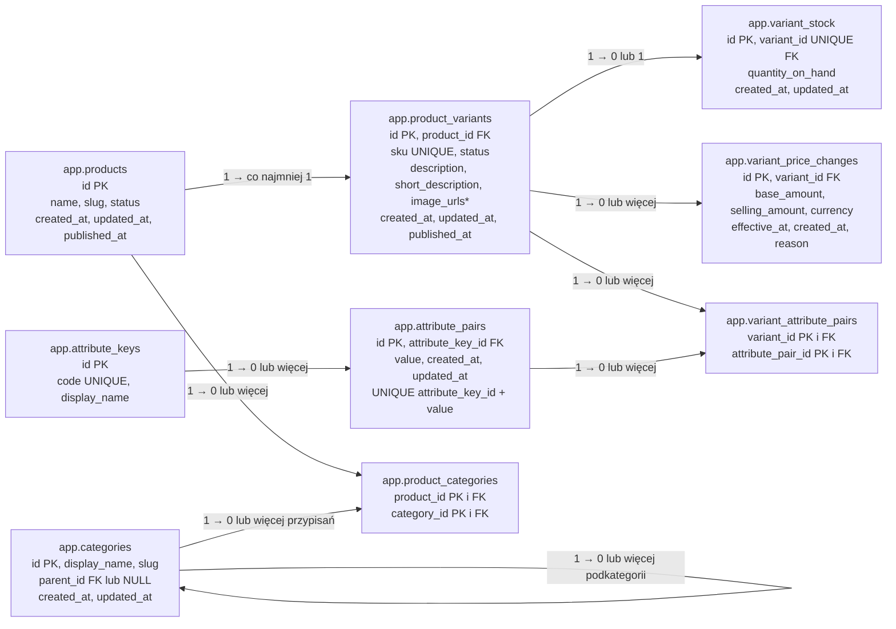

# Baza danych i Entity Framework Core

Cel: opisać własność schematów PostgreSQL, mapowanie EF Core i sposób bezpiecznego rozwijania danych aplikacji. Szczegóły obecnej tabeli są w [user-profiles.md](user-profiles.md).

## Koszyk i ulubione — migracja lokalna 01.11.2026

`20261101132248_AddShoppingCartsAndFavorites` tworzy cztery tabele `app`: `shopping_states` (UUID, konto albo skrót tokenu gościa, termin gościa, wersja i daty), `cart_items` (PK stan/wariant, ilość 1–99), `favorite_lists` (PK konta, unikalny UUID zakresu, wersja i daty) i `favorite_items` (PK konto/wariant, data). Koszyk i lista mają FK do istniejącego PK `auth.users.id`, bez zależności od opcjonalnego profilu. FK pozycji i kont używają kaskadowego usuwania.

CHECK wymaga dokładnie jednego rodzaju właściciela koszyka oraz terminu dla gościa. Częściowe unikalne indeksy chronią konto i skrót tokenu; indeks terminu umożliwia przyszłe czyszczenie. Nowe tabele mają RLS i odebrane uprawnienia `PUBLIC`, `anon`, `authenticated`, `service_role`. Funkcje triggerów nie używają `SECURITY DEFINER` i nie mają publicznego EXECUTE. Każdy odczyt/zapis API nadal filtruje po właścicielu potwierdzonym przez backend.

Triggery pozycji zwiększają wersję koszyka/listy także po SQL i usunięciu wariantu. API serializuje komendy danego właściciela blokadą wiersza, sprawdza zakres i wersję oraz limity liczby wpisów. Limity 100/500 są egzekwowane w serwisach, a CHECK 1–99 również w bazie. Reset katalogu zwiększa wersje i jawnie czyści obie tabele pozycji; zachowuje stany/listy oraz konta. Współdzielona blokada `(20261101,4)` komend i jej wyłączna postać w seederze zapobiegają zapisowi między zmianą wersji a TRUNCATE.

Migrację sprawdzono na nowej izolowanej bazie PostgreSQL 17. **Nie zastosowano jej w Supabase**; nie uruchamiać nowych operacji na zdalnej bazie przed uzgodnioną migracją. Model i granice odbioru: [koszyk i ulubione](cart-favorites-implementation-plan.md).

## Stan potwierdzony w kodzie i bazie

- `Program.cs` odczytuje `ConnectionStrings:SupabaseDatabase` i rejestruje `AppDbContext` z dostawcą Npgsql. Lokalnie wartość jest przechowywana w .NET user-secrets, nie w `appsettings.json` ani repozytorium.
- `Entities/UserProfile.cs` określa model w C#. `Data/AppDbContext.cs` mapuje go jawnie na `app.user_profiles`, kolumny `user_id`, `first_name`, `last_name`, klucz główny `user_id` i klucz obcy do `auth.users.id` z usuwaniem kaskadowym.
- `Data/AuthUserReference.cs` służy wyłącznie do mapowania relacji. `auth.users` jest wyłączona z migracji EF, ponieważ jej właścicielem jest Supabase Auth. Nie tworzymy ani nie zmieniamy jej przez migracje aplikacji.
- Migracja `20261017172821_CreateUserProfiles` utworzyła schemat `app` i tabelę `user_profiles`. Została zastosowana w bazie 17 października 2026 r.; EF widzi ją w swojej historii. Historia tych migracji jest w `public.__EcommerceMigrationsHistory`.
- Migracja włączyła RLS dla `app.user_profiles` i tabeli historii oraz odebrała dostęp do nich rolom `anon`, `authenticated` i `service_role`. Schemat `app` nie został dodany do schematów wystawianych przez Supabase Data API.
- `GET /auth/me` odczytuje profil przez `Services/Profile/UserProfileReader.cs`; `GET /profile/me` używa `AppDbContext` bezpośrednio. Oba odczyty filtrują po ID potwierdzonym przez Supabase Auth. `PUT /profile/me` wykonuje przez EF parametryzowany SQL `INSERT ... ON CONFLICT`, aby utworzyć lub zaktualizować profil w jednym poleceniu. W tym miejscu nie ma `SaveChangesAsync()`.

## Schematy i odpowiedzialność

Odczytowy audyt skonfigurowanego Supabase z 01.11.2026: raport oferty zwrócił 0 blokad i 0 ostrzeżeń; `AddCatalogManagement` i `AddCatalogPublicationRules` nadal oczekują na zastosowanie. Dane docelowe nie były zmieniane w ramach tego odbioru. Lokalny test aktualizacji zachował skrót wszystkich pól ceny historycznej i nie uzupełnił fikcyjnej daty publikacji; poprawnie odrzucił niekanoniczne cechy i niekompletną opublikowaną ofertę.

Rozszerzenie administracji ofertą (01.11.2026): `AddCatalogManagement` dodaje `version bigint` do produktów, wariantów, kategorii, kluczy cech i magazynu oraz prywatny, niezmienny dziennik `app.catalog_operations` z unikalnością autora/klucza ponowienia. Wyzwalacze zwiększają wersje grafu i rozszerzają wspólną blokadę zapisów katalogu. `AddCatalogPublicationRules` sprawdza istniejące dane, wymaga kanonicznych wartości NFC+trim i egzekwuje odroczone warunki publikacji oraz pierwszą datę. Nowe migracje sprawdzono **wyłącznie lokalnie**, bez zastosowania w Supabase. Przed wdrożeniem uruchomić odczytowy [raport danych](../scripts/catalog-preflight.sql); niezgodności wymagają jawnej korekty, bez automatycznego ukrywania/zmieniania historii. Szczegóły wersji, audytu i kolejności są w [dokumencie administracji](catalog-management-implementation-plan.md#13-wdrożenie-odbiór-lokalny-i-użycie).

Tabela `app.administrators` przechowuje PK `user_id` z FK do `auth.users.id` (`ON DELETE CASCADE`) i `created_at`. Migracja `20261031110337_AddAdministrators` włącza RLS i odbiera dostęp rolom Data API oraz PUBLIC. Zastosowano ją w skonfigurowanej bazie Supabase 31.10.2026. Nie tworzy administratorów i nie zmienia schematu `auth`. Zasady ręcznego nadania dostępu opisuje [dokument dostępu administratora](administrator-access.md). Seeder katalogu nie obejmuje tej tabeli.

| Schemat | Obecne użycie | Właściciel zmian |
| --- | --- | --- |
| `auth` | `auth.users` oraz inne obiekty uwierzytelniania | Supabase Auth |
| `app` | `user_profiles` oraz tabele katalogu, magazynu i historii cen | Backend i migracje EF Core |
| `public` | `__EcommerceMigrationsHistory` | EF Core dla tej jednej tabeli; nie jest miejscem profili |

Umieszczenie tabeli w `app` porządkuje własność danych. **Sama nazwa schematu nie przyznaje ani nie odbiera dostępu.** Liczą się także uprawnienia PostgreSQL, RLS, konfiguracja Data API oraz kontrola właściciela zasobu w backendzie. Połączenie EF z uprawnioną rolą PostgreSQL może omijać RLS; dlatego backend filtruje operacje po zweryfikowanym `user_id` i nie ufa ID przesłanemu przez klienta.

## Schemat katalogu, magazynu i cen

Poniższe dziewięć tabel ma encje, mapowanie EF Core i zastosowaną w Supabase migrację `20261022055417_AddCatalogInventoryAndPriceModels`. Historia EF została sprawdzona 22 października 2026 r.; użytkownik potwierdził widoczność tabel. Reguły i dalsze prace opisują [model katalogu](catalog-model.md), [model magazynu](inventory-model.md) oraz [model cen](pricing-model.md).

`image_urls*` jest zapisywane jako `text[]`. `variant_stock` może nie istnieć dla wariantu; **brak rekordu nie oznacza ilości zero i będzie blokować zakup wariantu** po wdrożeniu checkoutu. `variant_id` w tej tabeli jest unikalnym kluczem obcym, a jej własnym kluczem głównym jest `id`.

`variant_price_changes` przechowuje kolejne, niezmienne rekordy ceny wariantu. `base_amount` oznacza cenę podstawową, a `selling_amount` cenę oferowaną po promocji; bez promocji wartości są równe. Cena bieżąca pochodzi z ostatniego obowiązującego rekordu. Wariant bez ceny może być szkicem, ale nie może być opublikowany. Przy obliczaniu najniższej ceny z 30 dni przed obniżką uwzględnia się również ostatnią cenę obowiązującą na początku tego okresu; szczegóły i otwarte kwestie są w [modelu cen](pricing-model.md).

Migracja `20261028110446_AddCurrentPlnPriceIndex` dodaje częściowy indeks dla bieżącego odczytu cen PLN: `variant_id`, `effective_at DESC`, `created_at DESC`, `id DESC`, z dołączoną `selling_amount`. Lokalny pomiar na 43 467 rekordach cen wykazał, że PostgreSQL zastępuje sortowanie historii skanem indeksowym. Migrację zastosowano na odizolowanej bazie testowej oraz 28.10.2026 w skonfigurowanej bazie Supabase; ponowna lista migracji EF nie pokazuje oczekujących zmian.

Migracja `20261029140926_AddPriceChangeOperations` rozszerza historię cen o opcjonalne `operation_key`, `changed_by_user_id`, `previous_price_change_id`. Dodaje unikalność pary autor/klucz operacji, CHECK spójności metadanych oraz FK poprzedniej ceny z `RESTRICT`. Starsze dane pozostają bez metadanych. Autor jest audytowym UUID bez FK do konta. Migrację sprawdzono na izolowanym PostgreSQL 17 z istniejącymi rekordami; 31.10.2026 zastosowano ją także w skonfigurowanej bazie Supabase. Wewnętrzny serwis korzysta z krótkiej transakcji, blokady klucza operacji i wiersza wariantu; opis reguł jest w [modelu cen](pricing-model.md).

`categories.parent_id` tworzy drzewo kategorii bez stałego limitu głębokości, a `product_categories` pozwala przypisać produkt do wielu kategorii. `categories.display_name` jest wymagane i ma od 1 do 120 znaków po przycięciu białych znaków; `slug` jest wymagany i unikalny wśród kategorii mających tego samego rodzica, także wśród kategorii głównych. Zmiana `display_name` nie aktualizuje automatycznie `slug`, ale zapisany `slug` można zmienić ręcznie po walidacji. Przeniesienie kategorii wymaga wolnego `slug` w nowym miejscu i nie może utworzyć cyklu. Ścieżkę kategorii prezentujemy od korzenia do wybranego węzła. Pobranie produktów z kategorii obejmuje jej bezpośrednie przypisania oraz przypisania ze wszystkich podkategorii; wynik nie duplikuje produktów. Kategorii z podkategoriami lub przypisanymi produktami nie wolno usunąć. Szkic produktu może nie mieć kategorii, lecz publikacja wymaga przynajmniej jednego przypisania; projekt zabezpieczeń współbieżności i szczegóły są w [modelu katalogu](catalog-model.md#kategorie).

Produkt i wariant mają osobne statusy `Draft`, `Published` i `Hidden`. Status produktu jest nadrzędny: ukrycie produktu ukrywa wszystkie warianty bez zmiany ich statusów. Wariant może być widoczny tylko wtedy, gdy oba poziomy mają `Published`; szczegółowe reguły są w [modelu katalogu](catalog-model.md).

Samo FK z wariantu do produktu nie wymusi minimum jednego wariantu na produkt ani unikalnego zestawu par cech. Migracja zawiera odroczone wyzwalacze sprawdzające oba warunki na końcu transakcji, z blokadą wiersza produktu przy kontroli zestawów cech. Wymagają weryfikacji na PostgreSQL, zwłaszcza przy równoczesnych zapisach. Migracja włącza RLS i odbiera role Data API dostęp do nowych tabel. Nie zmienia schematu `auth`.

## Zasada przy dodawaniu kolejnej tabeli

Uzgodniony kierunek to tworzenie danych aplikacji w `app`, ale **EF nie ma ustawionego domyślnego schematu**. Przy nowej encji należy jawnie dodać mapowanie do `app` w `AppDbContext`, przygotować migrację i przejrzeć jej SQL przed zastosowaniem. Migracja aplikacji nie powinna modyfikować obiektów `auth` należących do Supabase. Jeśli tabela ma być osiągalna przez Supabase Data API, osobno ustal uprawnienia i polityki RLS; obecny profil jest udostępniany przez własne API.

Po zmianie modelu: wygeneruj migrację EF, sprawdź zakres tworzonych obiektów, oceń wpływ na seeder według [zasad jego utrzymania](seeder-maintenance.md), uruchom build i właściwe testy, a dopiero potem zastosuj migrację w wybranej bazie. Polecenie `dotnet ef migrations list` pokazuje historię, a `dotnet ef database update` stosuje oczekujące migracje. Szczegóły weryfikacji i otwarte punkty dla profilu są w [user-profiles.md](user-profiles.md).

## Otwarte sprawdzenia

Migracja jest zastosowana, ale nadal trzeba sprawdzić w prawdziwej bazie metadane klucza obcego i uprawnień oraz przeprowadzić test dwóch kont przez API. Testy jednostkowe nie potwierdzają tych właściwości środowiska Supabase.

## Promocje i historia oferty — 31.10.2026

Migracja `20261031120821_AddProductPromotions` jest zastosowana na odizolowanym PostgreSQL 17 i w skonfigurowanym Supabase. Dodaje pięć tabel `app`, bez zmian w `auth`:

- `promotions`: UUID, FK produktu, nazwa, rodzaj/wartość rabatu, stan, wersja, autor i daty. Kwoty reguły `numeric(18,2)`. PLN jest stałą pierwszej wersji serwisu, bez osobnego pola waluty promocji.
- `promotion_variants`: UUID, FK promocji i wariantu, daty udziału. Unikalna para promocja/wariant i unikalny `variant_id WHERE ended_at IS NULL`.
- `price_reductions`: UUID, unikalny FK udziału, FK wariantu, wcześniejsza cena `numeric(18,2)`, zakres i początek obniżki oraz `Full30Days`/`SinceFirstOffer`.
- `variant_offer_events`: `bigint` identity, FK wariantu, czas UTC, widoczność, kompletność historii od utworzenia, źródło `database`/`import`/`demo`. Indeks wariant/czas/ID.
- `promotion_operations`: UUID, autor/klucz UUID, FK promocji, komenda, hash żądania, wynik `jsonb`, kod sukcesu i czas. Unikalny autor/klucz; demonstracyjne operacje mają `kind=demo` bez autora i klucza.

`variant_price_changes` otrzymuje opcjonalne FK `promotion_operation_id` i `price_reduction_id`. CHECK metadanych dopuszcza dotychczasowe wpisy i nowy rodzaj ceny pochodnej, którego audyt pochodzi z operacji promocji. FK mają `RESTRICT`. Nowe tabele mają RLS i odebrany dostęp rolom Data API. Historia cen pozostaje niezmienna; dodatkowo triggery blokują UPDATE/DELETE zdarzeń oferty, zapisanych obniżek i operacji promocji.

Triggery rejestrują zmiany widoczności po zapisie wariantu, statusu produktu oraz przypisania kategorii. Używają rzeczywistego czasu transakcji, także przy SQL spoza API. Pierwszy stan istniejących wariantów to `source=import`, `complete_from_birth=false`; migracja nie odtwarza nieznanej przeszłości z `PublishedAt`.

Zapisy katalogu/pricingu są serializowane wspólną blokadą transakcyjną `(20261031,3)`: serwisy pobierają ją przed innymi blokadami, a SQL obejmują triggery BEFORE STATEMENT. Zwykłe odczyty nie pobierają tej blokady. Seeder ma spójny zakres 14 tabel w jednym `TRUNCATE ... RESTRICT`, z wyłączeniem kont, profili i administratorów.

Próba migracji na bazie 5000 produktów zachowała 43 467 cen i MD5 ID/podstawy/ceny sprzedaży/dat: `4784df91e3799f9e12edb2a5aac3296c`. Powstało 16 082 początkowych niepełnych zdarzeń importu. Testy PostgreSQL obejmują ograniczenia, wycofanie częściowego zapisu, współbieżność i ponowny reset. Szczegóły reguł: [promocje](promotion-implementation-plan.md).

Pełny zestaw migracji przetestowano również na nowej izolowanej bazie, następnie cofnięto i ponownie zastosowano migrację promocji bez danych. Po utworzeniu pochodnych cen migracja Down jawnie odmawia cofnięcia: wymagane jest zachowanie historii i kolejna migracja naprawcza, zamiast usuwania zapisów obniżek.

## Kolekcje i promocje kolekcji — 01.11.2026

Migracja `20261101124223_AddCollections` dodaje `app.collections`, `app.collection_products`, `app.collection_operations`. Pierwsza ma UUID, nazwę 120, unikalny slug 160, status Draft/Published/Hidden, wersję bigint i daty UTC. Powiązanie ma złożony PK kolekcja/produkt, datę i FK z RESTRICT. Dziennik ma UUID, autor/klucz, komendę, hash, wynik jsonb, kod i czas; unikalną parę autor/klucz oraz trigger niezmienności. Nowe tabele mają RLS i odebrany dostęp Data API.

`promotions.product_id` staje się nullable; dodano `scope` z domyślnym `product` i opcjonalny `collection_id`. CHECK wymaga dokładnie jednego celu zgodnego ze scope. Dotychczasowe promocje, wersje, zapisane operacje i historia cen nie są przepisywane.

Wersję kolekcji nadają wyłącznie triggery bazy: insert daje 1, update zawsze old+1 i zachowuje created_at. Każda zmiana przypisania aktualizuje kolekcję i jej wersję; może ona wzrosnąć wielokrotnie w jednej komendzie. Próba ustawienia ręcznej wersji w normalnym UPDATE nie omija tego mechanizmu. Publikację sprawdza odroczony constraint trigger na końcu transakcji: kolekcja musi mieć publiczny produkt. Późniejsze zmiany widoczności samych produktów nie zmieniają automatycznie statusu kolekcji. Operacje kolekcji i przypisań dołączają do wspólnej blokady `(20261031,3)` przez BEFORE STATEMENT. Nie tworzą zdarzeń oferty wariantu.

Próba aktualizacji lokalnej bazy 5000 produktów zachowała 45 029 cen (MD5 wszystkich pól `9fcc274f91cfc8462ebb33553553180f`) i 41 operacji promocji (MD5 `2f22f3f276705e4e8f0c5bf3393dbf92`), w tym 13 zakończonych i jedną aktywną promocję produktu. Sprawdzono również pełny zestaw migracji od zera oraz Down/Up bez danych. Down odmawia po powstaniu operacji kolekcji lub promocji collection, aby zachować ich historię. Szczegóły reguł i testów: [kolekcje](collection-implementation-plan.md).

Migrację kolekcji zastosowano 01.11.2026 również w skonfigurowanym Supabase; historia EF nie wskazuje oczekującej migracji `AddCollections`. Nie uruchamiano tam seedera ani testowego zapisu kolekcji. Katalog testowano na izolowanym PostgreSQL, rzeczywistą usługę Supabase wykorzystywano do Auth. Pełna instrukcja kontraktu: [api-contract.md](api-contract.md#kolekcje-i-promocje-kolekcji--01112026).
