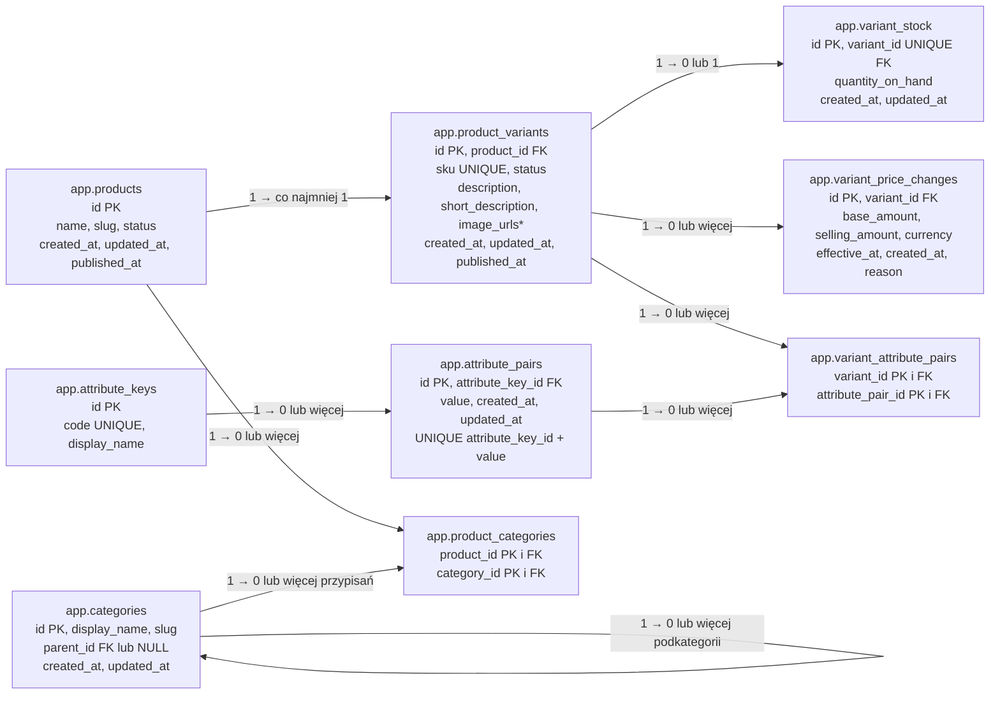

# Baza danych i Entity Framework Core

Cel: opisać własność schematów PostgreSQL, mapowanie EF Core i sposób bezpiecznego rozwijania danych aplikacji. Szczegóły obecnej tabeli są w [user-profiles.md](user-profiles.md).

## Stan potwierdzony w kodzie i bazie

- `Program.cs` odczytuje `ConnectionStrings:SupabaseDatabase` i rejestruje `AppDbContext` z dostawcą Npgsql. Lokalnie wartość jest przechowywana w .NET user-secrets, nie w `appsettings.json` ani repozytorium.
- `Entities/UserProfile.cs` określa model w C#. `Data/AppDbContext.cs` mapuje go jawnie na `app.user_profiles`, kolumny `user_id`, `first_name`, `last_name`, klucz główny `user_id` i klucz obcy do `auth.users.id` z usuwaniem kaskadowym.
- `Data/AuthUserReference.cs` służy wyłącznie do mapowania relacji. `auth.users` jest wyłączona z migracji EF, ponieważ jej właścicielem jest Supabase Auth. Nie tworzymy ani nie zmieniamy jej przez migracje aplikacji.
- Migracja `20261017172821_CreateUserProfiles` utworzyła schemat `app` i tabelę `user_profiles`. Została zastosowana w bazie 17 października 2026 r.; EF widzi ją w swojej historii. Historia tych migracji jest w `public.__EcommerceMigrationsHistory`.
- Migracja włączyła RLS dla `app.user_profiles` i tabeli historii oraz odebrała dostęp do nich rolom `anon`, `authenticated` i `service_role`. Schemat `app` nie został dodany do schematów wystawianych przez Supabase Data API.
- `GET /auth/me` odczytuje profil przez `Services/Profile/UserProfileReader.cs`; `GET /profile/me` używa `AppDbContext` bezpośrednio. Oba odczyty filtrują po ID potwierdzonym przez Supabase Auth. `PUT /profile/me` wykonuje przez EF parametryzowany SQL `INSERT ... ON CONFLICT`, aby utworzyć lub zaktualizować profil w jednym poleceniu. W tym miejscu nie ma `SaveChangesAsync()`.

## Schematy i odpowiedzialność

| Schemat | Obecne użycie | Właściciel zmian |
| --- | --- | --- |
| `auth` | `auth.users` oraz inne obiekty uwierzytelniania | Supabase Auth |
| `app` | `user_profiles`; uzgodnione miejsce dla przyszłych tabel aplikacji | Backend i migracje EF Core |
| `public` | `__EcommerceMigrationsHistory` | EF Core dla tej jednej tabeli; nie jest miejscem profili |

Umieszczenie tabeli w `app` porządkuje własność danych. **Sama nazwa schematu nie przyznaje ani nie odbiera dostępu.** Liczą się także uprawnienia PostgreSQL, RLS, konfiguracja Data API oraz kontrola właściciela zasobu w backendzie. Połączenie EF z uprawnioną rolą PostgreSQL może omijać RLS; dlatego backend filtruje operacje po zweryfikowanym `user_id` i nie ufa ID przesłanemu przez klienta.

## Planowany schemat katalogu, magazynu i cen

Poniższe dziewięć tabel to **uzgodniony wstępny model**, bez encji i migracji w kodzie. Reguły i pytania otwarte opisują [model katalogu](catalog-model.md), [model magazynu](inventory-model.md) oraz [model cen](pricing-model.md). Nazwy kolumn są robocze.

`image_urls*` oznacza logiczną listę zdjęć wariantu; jej fizyczny zapis w bazie pozostaje do ustalenia. `variant_stock` może nie istnieć dla wariantu; **brak rekordu nie oznacza ilości zero i blokuje zakup wariantu**. `variant_id` w tej tabeli jest unikalnym kluczem obcym, a jej własnym kluczem głównym jest `id`.

`variant_price_changes` przechowuje kolejne, niezmienne rekordy ceny wariantu. `base_amount` oznacza cenę podstawową, a `selling_amount` cenę oferowaną po promocji; bez promocji wartości są równe. Cena bieżąca pochodzi z ostatniego obowiązującego rekordu. Wariant bez ceny może być szkicem, ale nie może być opublikowany. Przy obliczaniu najniższej ceny z 30 dni przed obniżką uwzględnia się również ostatnią cenę obowiązującą na początku tego okresu; szczegóły i otwarte kwestie są w [modelu cen](pricing-model.md).

`categories.parent_id` tworzy drzewo kategorii bez stałego limitu głębokości, a `product_categories` pozwala przypisać produkt do wielu kategorii. `categories.display_name` jest wymagane i ma od 1 do 120 znaków po przycięciu białych znaków; `slug` jest wymagany i unikalny wśród kategorii mających tego samego rodzica, także wśród kategorii głównych. Zmiana `display_name` nie aktualizuje automatycznie `slug`, ale zapisany `slug` można zmienić ręcznie po walidacji. Przeniesienie kategorii wymaga wolnego `slug` w nowym miejscu i nie może utworzyć cyklu. Ścieżkę kategorii prezentujemy od korzenia do wybranego węzła. Pobranie produktów z kategorii obejmuje jej bezpośrednie przypisania oraz przypisania ze wszystkich podkategorii; wynik nie duplikuje produktów. Kategorii z podkategoriami lub przypisanymi produktami nie wolno usunąć. Szkic produktu może nie mieć kategorii, lecz publikacja wymaga przynajmniej jednego przypisania; projekt zabezpieczeń współbieżności i szczegóły są w [modelu katalogu](catalog-model.md#kategorie).

Produkt i wariant mają osobne statusy `Draft`, `Published` i `Hidden`. Status produktu jest nadrzędny: ukrycie produktu ukrywa wszystkie warianty bez zmiany ich statusów. Wariant może być widoczny tylko wtedy, gdy oba poziomy mają `Published`; szczegółowe reguły są w [modelu katalogu](catalog-model.md).

Samo FK z wariantu do produktu nie wymusi minimum jednego wariantu na produkt. Nie zapewni również unikalnego zestawu par cech dla wariantów tego samego produktu. Obie reguły trzeba zaprojektować osobno, z uwzględnieniem równoczesnych zapisów, przed migracją.

## Zasada przy dodawaniu kolejnej tabeli

Uzgodniony kierunek to tworzenie danych aplikacji w `app`, ale **EF nie ma ustawionego domyślnego schematu**. Przy nowej encji należy jawnie dodać mapowanie do `app` w `AppDbContext`, przygotować migrację i przejrzeć jej SQL przed zastosowaniem. Migracja aplikacji nie powinna modyfikować obiektów `auth` należących do Supabase. Jeśli tabela ma być osiągalna przez Supabase Data API, osobno ustal uprawnienia i polityki RLS; obecny profil jest udostępniany przez własne API.

Po zmianie modelu: wygeneruj migrację EF, sprawdź zakres tworzonych obiektów, uruchom build i właściwe testy, a dopiero potem zastosuj migrację w wybranej bazie. Polecenie `dotnet ef migrations list` pokazuje historię, a `dotnet ef database update` stosuje oczekujące migracje. Szczegóły weryfikacji i otwarte punkty dla profilu są w [user-profiles.md](user-profiles.md).

## Otwarte sprawdzenia

Migracja jest zastosowana, ale nadal trzeba sprawdzić w prawdziwej bazie metadane klucza obcego i uprawnień oraz przeprowadzić test dwóch kont przez API. Testy jednostkowe nie potwierdzają tych właściwości środowiska Supabase.
