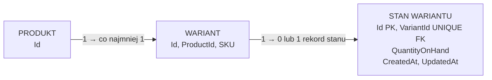

# Wstępny model stanu magazynowego

Cel: opisać powiązanie stanu magazynowego z wariantem oraz pytania, które trzeba rozstrzygnąć przed modelem checkoutu. Model produktu i wariantu jest w [modelu katalogu](catalog-model.md).

## Stan potwierdzony w kodzie

Backend ma encję `VariantStock`, mapowanie EF Core i zastosowaną w Supabase migrację tworzącą `app.variant_stock` z własnym UUID, unikalnym `variant_id`, nieujemnym `quantity_on_hand` oraz datami UTC. Nie ma operacji magazynowych, rezerwacji ani checkoutu; reguła blokowania zakupu bez rekordu stanu zostanie wdrożona w checkoutcie.

## Ustalenie z właścicielem projektu

Każdy wariant produktu ma mieć możliwość posiadania **własnego stanu magazynowego**. Wariant może mieć zero albo jeden rekord stanu; brak rekordu oznacza, że ilość nie jest dla niego określona, a nie że wynosi `0`. **Backend blokuje zakup wariantu bez rekordu stanu**, ponieważ nie zna jego ilości. Reguła musi być sprawdzana przy składaniu zamówienia, także gdy wariant został wcześniej dodany do koszyka. Ilość jednego wariantu nie jest wspólną ilością produktu ani innych wariantów. Przykład: koszulka `czerwona/S` może mieć stan 5, a `czerwona/M` stan 12.

Rekord stanu ma mieć własne `Id`, `CreatedAt` i `UpdatedAt`. `VariantId` nadal wskazuje wariant; nie jest identyfikatorem rekordu stanu. Źródło: ustalenie z właścicielem projektu z 21 października 2026 r.

## Uzgodniony wstępny kształt rekordu

Stan jest oddzielony od danych opisowych wariantu w relacji zero albo jeden rekord stanu na wariant:

| Tabela `app` | Pola | Znaczenie |
| --- | --- | --- |
| `variant_stock` | `id uuid` PK; `variant_id uuid` NOT NULL UNIQUE FK → `product_variants.id`; `quantity_on_hand integer`; `created_at`, `updated_at` (UTC) | Osobny identyfikator i daty rekordu stanu. UNIQUE na `variant_id` pozwala przypisać wariantowi najwyżej jeden rekord. `quantity_on_hand` roboczo oznacza liczbę fizycznie posiadanych sztuk. |

Roboczo `quantity_on_hand` nie może być ujemne. Wariant ze śledzonym stanem, ale bez fizycznie posiadanych sztuk miałby wartość `0`. Sama definicja ilości fizycznie posiadanej jest propozycją do potwierdzenia przed modelem rezerwacji.

Oddzielna tabela pozwala zmieniać ilość niezależnie od opisu i zdjęć wariantu. Encja i migracja są w kodzie; działanie ograniczeń pozostaje do sprawdzenia na PostgreSQL.

## Pytania otwarte

1. Czy `QuantityOnHand` oznacza sztuki fizycznie posiadane, sztuki dostępne do sprzedaży, czy oba pojęcia trzeba przechowywać osobno? Przy rezerwacjach dostępność może różnić się od stanu fizycznego.
2. Kiedy pomniejszać lub rezerwować ilość: przy rozpoczęciu checkoutu, utworzeniu zamówienia czy potwierdzeniu płatności? Co robić po nieudanej płatności lub porzuconym checkoutcie?
3. Czy dopuszczać sprzedaż przy istniejącym rekordzie ze stanem `0` (przedsprzedaż lub backorder), czy blokować zakup? Brak rekordu zawsze blokuje zakup.
4. Jak zapisywać korekty i ich powody oraz jak chronić ostatnią sztukę przed równoczesnym zakupem przez dwie osoby?

Te odpowiedzi wyznaczą model rezerwacji i zmian stanu. Samo pole z ilością nie rozwiązuje jeszcze spójności checkoutu.
