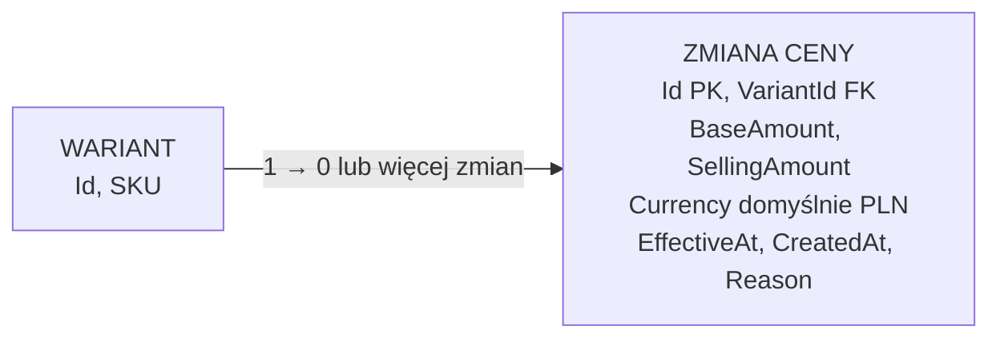

# Wstępny model ceny wariantu

Cel: zapisać decyzje o cenie wariantu i sposobie przechowywania zmian cen, zanim powstaną promocje, koszyk i zamówienia. Model wariantu jest w [modelu katalogu](catalog-model.md), a kolejność prac w [planie backendu](project-direction.md).

## Stan potwierdzony w kodzie

Backend ma encję `VariantPriceChange`, mapowanie EF Core i zastosowaną w Supabase migrację tworzącą `app.variant_price_changes`. Kwoty są mapowane na `numeric(18,2)`, waluta ma domyślnie `PLN`, a indeks obejmuje wariant, walutę i daty zdarzenia. Migracja blokuje aktualizację i usuwanie rekordów historii cen przez `UPDATE` i `DELETE`. Ręczny endpoint developerski [seedera](demo-seed.md) wykonuje pełny `TRUNCATE` dziewięciu tabel katalogowych, w tym historii cen, omijając ten wyzwalacz; jest przeznaczony tylko dla bazy z danymi do odtworzenia. Nie ma jeszcze operacji dodawania ceny, wyznaczania ceny bieżącej, obliczania najniższej ceny przed obniżką ani promocji. Weryfikacja działania wyzwalacza i zapytań na PostgreSQL pozostaje do wykonania.

## Ustalenia z właścicielem projektu

- Każdy wariant może mieć własną cenę; cena nie jest jedną wspólną wartością produktu.
- Cena ma zawierać kwotę i walutę. Domyślna waluta to złoty polski, zapisywany kodem `PLN`.
- Wariant bez ceny może mieć `Status=Draft`. Bieżąca cena jest obowiązkowa **przed zmianą wariantu na `Published`**. Wariant może być widoczny i sprzedawany tylko wtedy, gdy zarówno on, jak i nadrzędny produkt mają `Status=Published`; `Hidden` na produkcie ukrywa wszystkie warianty. Szczegóły reguł widoczności są w [modelu katalogu](catalog-model.md).
- Promocje i wyliczana cena promocyjna będą modelowane osobno; nie nadpisują po prostu ceny podstawowej wariantu.
- **Wymaganie dla całego modelu cenowego:** musi on pozwalać odtworzyć ceny, które obowiązywały przed ogłoszeniem obniżki, tak aby sklep mógł prezentować wymaganą informację o najniższej wcześniejszej cenie. Nie wolno wdrożyć edycji ceny, która zachowuje tylko bieżącą kwotę i traci historię. Dotyczy to również przyszłych cen wynikających z promocji; sama historia ceny podstawowej nie wystarczy. Podstawa zakresu informacji: [UOKiK — informacje o obniżkach cen](https://prawakonsumenta.uokik.gov.pl/prawo-do-informacji/informacje-o-obnizkach-cen/).
- Historię cen przechowujemy jako kolejne rekordy zmian. Zmiana nie nadpisuje ani nie zamyka poprzedniego rekordu; dodaje nowy. Migracja zawiera wyzwalacz blokujący aktualizację i usuwanie zapisanych zmian, ale nie ma jeszcze operacji dodawania ceny.

## Uzgodniony wstępny schemat historii cen

| Tabela `app` | Pola | Znaczenie |
| --- | --- | --- |
| `variant_price_changes` | `id uuid` PK; `variant_id uuid` FK → `product_variants.id`; `base_amount decimal`; `selling_amount decimal`; `currency char(3)` DEFAULT `PLN`; `effective_at` UTC; `created_at` UTC; `reason` | Jeden wiersz utrwala stan ceny wariantu od chwili `effective_at`. Nazwy pól i wartości `reason` są robocze. |

`base_amount` to cena podstawowa wariantu, a `selling_amount` to cena faktycznie oferowana po zastosowaniu promocji. Bez promocji obie kwoty są równe. `reason` wyjaśnia, dlaczego dopisano rekord, np. ustawienie pierwszej ceny, zmiana ceny podstawowej, rozpoczęcie, zmiana lub zakończenie promocji. `created_at` oznacza moment zapisania rekordu, a `effective_at` — moment, od którego cena obowiązuje. Rekordów nie aktualizujemy; dlatego historia nie ma `updated_at` ani `valid_to`.

Przykład dla jednego wariantu:

| `effective_at` | `base_amount` | `selling_amount` | `reason` |
| --- | ---: | ---: | --- |
| 1 października | 120 PLN | 120 PLN | Pierwsza cena |
| 10 października | 120 PLN | 90 PLN | Start promocji |
| 15 października | 120 PLN | 120 PLN | Koniec promocji |
| 20 października | 110 PLN | 110 PLN | Zmiana ceny podstawowej |

Cena bieżąca pochodzi z ostatniego rekordu wariantu i waluty z `effective_at` nie późniejszym niż bieżący moment. Przy zmianie ceny podstawowej podczas promocji także trzeba dopisać nowy rekord z ponownie wyliczoną ceną sprzedaży. Osobna kopia bieżącej kwoty nie jest na starcie potrzebna. Wariant bez żadnego obowiązującego rekordu może pozostać szkicem, ale nie może zostać opublikowany.

Do wyznaczenia najniższej ceny z 30 dni przed obniżką porównujemy `selling_amount`. Nie wystarczy pobrać samych zmian zapisanych w tym oknie. Trzeba uwzględnić **ostatni rekord obowiązujący na początku okna** oraz wszystkie późniejsze zmiany aż do chwili rozpoczęcia obniżki. Przykładowo cena `100 PLN` ustawiona 40 dni wcześniej nadal mogła obowiązywać przez całe ostatnie 30 dni, mimo że w tym czasie nie dodano żadnego rekordu. Nowej ceny obniżonej nie wliczamy do okresu *przed* obniżką. Dla oferty krótszej niż 30 dni początek okna wyznacza początek oferowania wariantu. Do porównania bierzemy okresy, w których wariant był rzeczywiście oferowany; obsługa ukrycia i ponownej publikacji wymaga doprecyzowania.

Rekordy historii nie mogą być usuwane przez ogólne zadanie czyszczące po 30 dniach: starszy rekord może być potrzebny do ustalenia ceny na początku okna i do odtworzenia wcześniejszej oferty. Brak obowiązującego rekordu odpowiada wariantowi bez ceny; taki wariant nie może zostać opublikowany ani sprzedany. Przed implementacją trzeba ustalić m.in. precyzję kwot, sposób jednoznacznego porządkowania zmian z tą samą datą i obsługę zmian zaplanowanych na przyszłość.

## Granica z promocjami i wymogiem wcześniejszej ceny

Reguły promocji będą osobnym modelem. Kiedy promocja zacznie, zmieni lub przestanie wpływać na cenę wariantu, backend dopisze jego nowy rekord ceny z wyliczonym `selling_amount`. Historia obejmie wtedy cenę **faktycznie oferowaną klientowi**, a nie tylko cenę podstawową. Szczegółowy sposób powiązania rekordu z promocją, zasady nakładania promocji i rabaty zależne od koszyka lub klienta pozostają do ustalenia.

Według [informacji UOKiK o obniżkach](https://prawakonsumenta.uokik.gov.pl/prawo-do-informacji/informacje-o-obnizkach-cen/) przy informowaniu o obniżce należy pokazać najniższą cenę obowiązującą w okresie 30 dni przed jej wprowadzeniem; dla oferty krótszej niż 30 dni liczy się okres od rozpoczęcia sprzedaży. [UOKiK zwraca też uwagę](https://www.uokik.gov.pl/public/tajemnicze-i-zwodnicze-promocje-na-temu) na spójność tej informacji między wariantami i przy kolejnych zmianach cen promocyjnych. Szczegółową interpretację dla wybranych rodzajów promocji trzeba sprawdzić przed wdrożeniem.

## Pytania otwarte

1. Jakie przejścia między `Draft`, `Published` i `Hidden` dopuszczać oraz czy `PublishedAt` oznacza pierwszą czy ostatnią publikację?
2. Czy na starcie sklep sprzedaje wyłącznie w PLN, pozostawiając pole waluty na przyszłość, czy dopuszcza równoczesne ceny w kilku walutach?
3. W bazie przyjęto `numeric(18,2)`. Jaka jest zasada zaokrąglania w obliczeniach i czy przechowujemy cenę brutto, netto, czy obie?
4. Czy zmiana ceny może być zaplanowana na przyszłość? Jak obsłużyć równoczesne zmiany ceny tego samego wariantu?
5. Jak powiązać zmianę ceny z regułą promocji, obsłużyć nakładanie promocji oraz rabaty zależne od koszyka lub klienta? Jak niezawodnie dopisywać rekordy przy rozpoczęciu i zakończeniu promocji?
6. Jak odtworzyć dokładne okresy publicznego oferowania wariantu, gdy produkt lub wariant jest ukrywany i ponownie publikowany?
