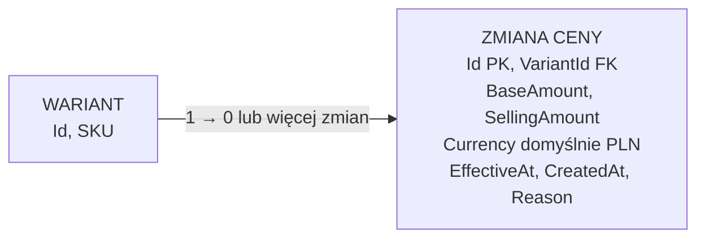

# Wstępny model ceny wariantu

Cel: zapisać decyzje o cenie wariantu i sposobie przechowywania zmian cen, zanim powstaną promocje, koszyk i zamówienia. Model wariantu jest w [modelu katalogu](catalog-model.md), a kolejność prac w [planie backendu](project-direction.md).

## Stan potwierdzony w kodzie

Backend ma encję `VariantPriceChange`, mapowanie EF Core i zastosowaną w Supabase migrację tworzącą `app.variant_price_changes`. Kwoty są mapowane na `numeric(18,2)`, waluta ma domyślnie `PLN`, a indeks obejmuje wariant, walutę i daty zdarzenia. Migracja blokuje aktualizację i usuwanie rekordów historii cen przez `UPDATE` i `DELETE`. Ręczny endpoint developerski [seedera](demo-seed.md) wykonuje pełny `TRUNCATE` dziewięciu tabel katalogowych, w tym historii cen, omijając ten wyzwalacz; jest przeznaczony tylko dla bazy z danymi do odtworzenia. Odczyt szczegółów produktu wybiera bieżącą cenę sprzedaży wariantu osobno dla każdej waluty. Wewnętrzny `VariantPriceService` dopisuje zwykłą cenę PLN z kontrolą wersji i ponowień. Administracyjny kontroler udostępnia bieżącą cenę, zapis oraz historię. Obliczanie najniższej ceny przed obniżką i promocje pozostają do wdrożenia. Automatyczne testy na PostgreSQL potwierdziły blokadę `UPDATE` i `DELETE`. Migracje metadanych operacji i dostępu administratora zastosowano w skonfigurowanej bazie Supabase 31.10.2026.

## Ustalenia z właścicielem projektu

- Każdy wariant może mieć własną cenę; cena nie jest jedną wspólną wartością produktu.
- Cena ma zawierać kwotę i walutę. Domyślna waluta to złoty polski, zapisywany kodem `PLN`.
- Wariant bez ceny może mieć `Status=Draft`. Bieżąca cena jest obowiązkowa **przed zmianą wariantu na `Published`**. Wariant może być widoczny i sprzedawany tylko wtedy, gdy zarówno on, jak i nadrzędny produkt mają `Status=Published`; `Hidden` na produkcie ukrywa wszystkie warianty. Szczegóły reguł widoczności są w [modelu katalogu](catalog-model.md).
- Promocje i wyliczana cena promocyjna będą modelowane osobno; nie nadpisują po prostu ceny podstawowej wariantu.
- **Wymaganie dla całego modelu cenowego:** musi on pozwalać odtworzyć ceny, które obowiązywały przed ogłoszeniem obniżki, tak aby sklep mógł prezentować wymaganą informację o najniższej wcześniejszej cenie. Nie wolno wdrożyć edycji ceny, która zachowuje tylko bieżącą kwotę i traci historię. Dotyczy to również przyszłych cen wynikających z promocji; sama historia ceny podstawowej nie wystarczy. Podstawa zakresu informacji: [UOKiK — informacje o obniżkach cen](https://prawakonsumenta.uokik.gov.pl/prawo-do-informacji/informacje-o-obnizkach-cen/).
- Historię cen przechowujemy jako kolejne rekordy zmian. Zmiana nie nadpisuje ani nie zamyka poprzedniego rekordu; dodaje nowy. Wyzwalacz blokuje aktualizację i usuwanie zapisanych zmian, a wewnętrzny serwis dopisuje nowe rekordy zwykłej ceny.

## Uzgodniony wstępny schemat historii cen

| Tabela `app` | Pola | Znaczenie |
| --- | --- | --- |
| `variant_price_changes` | `id uuid` PK; `variant_id uuid` FK → `product_variants.id`; `base_amount decimal`; `selling_amount decimal`; `currency char(3)` DEFAULT `PLN`; `effective_at` UTC; `created_at` UTC; `reason` | Jeden wiersz utrwala stan ceny wariantu od chwili `effective_at`. Nazwy pól i wartości `reason` są robocze. |

`base_amount` to cena podstawowa wariantu, a `selling_amount` to cena faktycznie oferowana po zastosowaniu promocji. Bez promocji obie kwoty są równe. `reason` wyjaśnia, dlaczego dopisano rekord, np. ustawienie pierwszej ceny, zmiana ceny podstawowej, rozpoczęcie, zmiana lub zakończenie promocji. `created_at` oznacza moment zapisania rekordu, a `effective_at` — moment, od którego cena obowiązuje. Rekordów nie aktualizujemy; dlatego historia nie ma `updated_at` ani `valid_to`.

Przykład dla jednego wariantu:

| `effective_at` | `base_amount` | `selling_amount` | `reason` |
| --- | ---: | ---: | --- |
| 1 października | 120 PLN | 120 PLN | Pierwsza cena |
| 10 października | 120 PLN | 90 PLN | Start promocji |
| 15 października | 120 PLN | 120 PLN | Koniec promocji |
| 20 października | 110 PLN | 110 PLN | Zmiana ceny podstawowej |

Cena bieżąca pochodzi z ostatniego rekordu wariantu i waluty z `effective_at` nie późniejszym niż bieżący moment. Przy zmianie ceny podstawowej podczas promocji także trzeba dopisać nowy rekord z ponownie wyliczoną ceną sprzedaży. Osobna kopia bieżącej kwoty nie jest na starcie potrzebna. Wariant bez żadnego obowiązującego rekordu może pozostać szkicem, ale nie może zostać opublikowany.

Do wyznaczenia najniższej ceny z 30 dni przed obniżką porównujemy `selling_amount`. Nie wystarczy pobrać samych zmian zapisanych w tym oknie. Trzeba uwzględnić **ostatni rekord obowiązujący na początku okna** oraz wszystkie późniejsze zmiany aż do chwili rozpoczęcia obniżki. Przykładowo cena `100 PLN` ustawiona 40 dni wcześniej nadal mogła obowiązywać przez całe ostatnie 30 dni, mimo że w tym czasie nie dodano żadnego rekordu. Nowej ceny obniżonej nie wliczamy do okresu *przed* obniżką. Dla oferty krótszej niż 30 dni początek okna wyznacza początek oferowania wariantu. Do porównania bierzemy okresy, w których wariant był rzeczywiście oferowany; obsługa ukrycia i ponownej publikacji wymaga doprecyzowania.

Rekordy historii nie mogą być usuwane przez ogólne zadanie czyszczące po 30 dniach: starszy rekord może być potrzebny do ustalenia ceny na początku okna i do odtworzenia wcześniejszej oferty. Brak obowiązującego rekordu odpowiada wariantowi bez ceny; taki wariant nie może zostać opublikowany ani sprzedany. Odczyt produktu pomija przyszłe zmiany i przy tej samej dacie skuteczności porządkuje rekordy po `created_at`, a następnie `id` malejąco. Pozostałe decyzje, m.in. precyzja kwot i administracyjna obsługa zmian zaplanowanych na przyszłość, wymagają ustalenia przed zapisem cen.

## Granica z promocjami i wymogiem wcześniejszej ceny

Reguły promocji będą osobnym modelem. Kiedy promocja zacznie, zmieni lub przestanie wpływać na cenę wariantu, backend dopisze jego nowy rekord ceny z wyliczonym `selling_amount`. Historia obejmie wtedy cenę **faktycznie oferowaną klientowi**, a nie tylko cenę podstawową. Szczegółowy sposób powiązania rekordu z promocją, zasady nakładania promocji i rabaty zależne od koszyka lub klienta pozostają do ustalenia.

Według [informacji UOKiK o obniżkach](https://prawakonsumenta.uokik.gov.pl/prawo-do-informacji/informacje-o-obnizkach-cen/) przy informowaniu o obniżce należy pokazać najniższą cenę obowiązującą w okresie 30 dni przed jej wprowadzeniem; dla oferty krótszej niż 30 dni liczy się okres od rozpoczęcia sprzedaży. [UOKiK zwraca też uwagę](https://www.uokik.gov.pl/public/tajemnicze-i-zwodnicze-promocje-na-temu) na spójność tej informacji między wariantami i przy kolejnych zmianach cen promocyjnych. Szczegółową interpretację dla wybranych rodzajów promocji trzeba sprawdzić przed wdrożeniem.

## Odczyt cen w katalogu

Cel: opisać wdrożone sortowanie i filtrowanie list produktów po bieżącej cenie, bez operacji zapisu. Stan poniżej jest potwierdzony w kodzie i ręcznych próbach HTTP z PostgreSQL. Źródło założenia walutowego: właściciel projektu, 28.10.2026. Pełny format żądań i odpowiedzi opisuje [kontrakt API](api-contract.md).

### Przyjęte założenie

W odczycie katalogu porównujemy wyłącznie bieżące kwoty `selling_amount` w `PLN`. Pole `currency` i historia cen pozostają w schemacie; ta decyzja nie oznacza jeszcze zakazu zapisywania innych walut w przyszłych operacjach administracyjnych. Nie przeliczamy walut. Produkt z samymi cenami w innej walucie nie spełni filtra cenowego; przy sortowaniu po cenie trafi na koniec listy, za produkty z ceną `PLN`, w obu kierunkach sortowania.

### Reguła ceny produktu

- Cena należy do **wariantu**. Dla każdego wariantu wybieramy ostatni rekord `PLN` z `effective_at <= now`, rozstrzygając remisy przez `created_at` i `id`. Bierzemy `selling_amount`; przyszłe rekordy i historyczne kwoty nie wpływają na bieżący wynik.
- Jedną ceną produktu używaną do sortowania jest **najniższa bieżąca cena kwalifikującego się wariantu**. Tę samą regułę stosujemy przy `price-asc` i `price-desc`; kierunek sortowania nie zmienia jej na maksimum. Remisy rozstrzyga `product.id`, aby strony miały stabilną kolejność.
- Filtr `minPrice`/`maxPrice` jest domknięty (`>=` / `<=`) i sprawdza cenę **tego samego wariantu**, który spełnia filtry cech i ewentualne trafienie `q` w SKU. Warianty ukryte, bez obecnej ceny lub bez ceny `PLN` nie kwalifikują się. Dopasowanie `q` do nazwy produktu dopuszcza każdy kwalifikujący się wariant.
- Przy wyszukiwaniu `pricesFrom` i miniatura na kafelku wynikają z wariantów spełniających cały aktualny zestaw warunków, także `q` trafiające w SKU. Przy aktywnym zakresie ceny kafelek zwraca wyłącznie kwotę w PLN. Liczniki `availableFilters` uwzględniają zakres ceny, zachowując zasadę pomijania własnego filtra cechy.
- Zakres ceny służy wyszukiwaniu bieżącej oferty. Nie oblicza minimum sprzed obniżki i nie zastępuje późniejszego wymogu Omnibus; historia cen pozostaje nienaruszona.

### Wdrożenie i granica weryfikacji

- `GET /products/catalog` i `GET /products/by-category` przyjmują `minPrice` i `maxPrice` w query; `POST /products/search` przyjmuje je w JSON. Wszystkie trzy przyjmują `sort=price-asc` lub `price-desc`. Granice są domknięte; dozwolone są kwoty nieujemne z dokładnością do 0,01 i w zakresie `numeric(18,2)`. Odwrócony lub błędny zakres daje `400`.
- Wspólne zapytanie o ostatnią obowiązującą cenę PLN wariantu uczestniczy w dopasowaniu i sortowaniu. Najniższa cena produktu jest wyznaczana w PostgreSQL przed stronicowaniem; historia nie jest pobierana w całości do pamięci tylko po to, by sortować. `GET /products/filter-options` pozostaje ogólnym słownikiem bez zakresu ceny.
- Ręczne próby HTTP z PostgreSQL potwierdziły sortowanie w obu kierunkach, filtrowanie z jedną lub dwiema granicami, granicę równą 90 PLN, zgodność ceny z wariantem trafionym przez SKU i cechy, liczniki filtrów, brak nakładania stron oraz `400` dla błędnych kwot. Test jednostkowy sprawdza walidację zakresu przed dostępem do bazy.
- Automatyczny test `ProductSearchPostgresTests` sprawdza pomijanie przyszłej ceny i wariant bez PLN. `PriceChangePostgresTests` sprawdza operacje zmiany zwykłej ceny, niezmienność historii i współbieżne zapisy. Wyliczanie wcześniejszej ceny dla obniżek pozostaje do wdrożenia i przetestowania.

Zmiana dotyczy wyłącznie odczytu. Nie zmienia schematu bazy ani seedera.

## Pytania otwarte

1. Jakie przejścia między `Draft`, `Published` i `Hidden` dopuszczać oraz czy `PublishedAt` oznacza pierwszą czy ostatnią publikację?
2. Dla planowanego odczytu katalogu przyjęto tymczasowo wyłącznie `PLN`. Czy zapis cen i cały proces sprzedaży mają formalnie blokować inne waluty? Tego nie ustalono; pole waluty pozostaje w modelu.
3. W bazie przyjęto `numeric(18,2)`. Jaka jest zasada zaokrąglania w obliczeniach i czy przechowujemy cenę brutto, netto, czy obie?
4. Czy zmiana ceny może być zaplanowana na przyszłość? Jak obsłużyć równoczesne zmiany ceny tego samego wariantu?
5. Jak powiązać zmianę ceny z regułą promocji, obsłużyć nakładanie promocji oraz rabaty zależne od koszyka lub klienta? Jak niezawodnie dopisywać rekordy przy rozpoczęciu i zakończeniu promocji?
6. Jak odtworzyć dokładne okresy publicznego oferowania wariantu, gdy produkt lub wariant jest ukrywany i ponownie publikowany?

## Propozycja wdrożenia modułu 3 — analiza z 28.10.2026

Status: propozycja przygotowana na prośbę właściciela projektu. Rozpoczęto realizację pierwszego etapu 29.10.2026; rzeczywisty zakres opisuje sekcja poniżej. Pozostałe endpointy, modele i reguły są propozycjami. Stan na 31.10.2026: uprawnienia administratora i trzy endpointy ceny są wdrożone; model promocji pozostaje propozycją. Lista obszarów chronionych jest obecnie pusta.

### Pierwszy zakres i reguły do uzgodnienia

- Zapis cen wyłącznie w PLN, jako ceny brutto; waluta pozostaje w modelu. Obecna decyzja o PLN dotyczyła odczytu, więc rozszerzenie jej na zapis wymaga ustalenia.
- Kwoty wejściowe z maksymalnie dwoma miejscami po przecinku. Obliczenia na `decimal`, zaokrąglenie wyniku rabatu raz, do grosza; proponowany tryb to `MidpointRounding.AwayFromZero`. Należy osobno ustalić dopuszczenie ceny zerowej; baza obecnie ją dopuszcza.
- Pierwszy zapis administracyjny obowiązuje od teraz, z czasem nadanym przez backend. Planowanie i wpisy wsteczne wymagają osobnego zakresu; nie należy zmieniać zapisanej historii, aby korygować błędy.
- Cena podstawowa jest wejściem administratora, a sprzedażowa wynikiem obliczenia backendu. Bez promocji są równe. Podczas promocji zmiana podstawy ponownie wylicza cenę sprzedaży i zapisuje wynik w historii.
- Propozycja początkowa: jedna aktywna promocja na wariant, konflikt przy próbie uruchomienia drugiej. Regułę można później rozszerzyć o wybór najkorzystniejszej promocji. Rabat kwotowy przekraczający cenę jest błędem, zamiast automatycznie tworzyć kwotę ujemną.
- Kolekcja to proponowana ręczna grupa produktów, niezależna od drzewa kategorii. Zakres promocji: produkty, kolekcje albo cały katalog; bezpośrednie wskazywanie wariantów można dodać jako rozszerzenie. Zniżkę zawsze obliczamy osobno dla każdego wariantu.
- Przy aktywacji utrwalamy listę objętych wariantów. Dodany później produkt nie dołącza automatycznie do aktywnej akcji. To proponowane uproszczenie, które trzeba zaakceptować dla promocji całego katalogu i kolekcji.

### Potrzebne dane

| Obszar | Proponowana zmiana | Powód |
| --- | --- | --- |
| Historia cen | Zachować `variant_price_changes`; dodać powiązanie z operacją, administratorem, promocją i zdarzeniem obniżki oraz uporządkowany typ przyczyny | Odtworzenie, kto i dlaczego zmienił cenę; tekst `reason` pozostaje komentarzem |
| Kolejność zmian | Rozważyć sekwencję zmian per wariant i waluta, nadawaną pod blokadą, z unikalnym indeksem | Jednoznaczne rozstrzygnięcie identycznych czasów; migracja musi zachować obecną kolejność starszych rekordów |
| Promocja | `Id`, `Name`, `DiscountType`, `DiscountValue`, `Scope`, `Status`, daty utworzenia/zmiany oraz rzeczywistej aktywacji/zakończenia | Cykl `Draft → Active → Ended`; edytowalny jest szkic, aktywna reguła zachowuje swoją treść |
| Cele promocji | Relacje do produktów lub kolekcji oraz utrwalone przypisania promocja–wariant | Jawny zakres i możliwość sprawdzenia konfliktu dla wariantu |
| Kolekcje | `collections` i `collection_products` | Obsługa grup marketingowych niezależnych od kategorii |
| Zdarzenie obniżki | Wariant, waluta, moment rozpoczęcia, poprzedzający zakres odniesienia, najniższa cena, informacja o kompletności historii | Stały punkt odniesienia dla konkretnej ogłaszanej obniżki |
| Okresy oferowania | Rejestr rozpoczęcia i zakończenia faktycznej publicznej oferty wariantu | Obecne `PublishedAt` nie odtwarza ukryć i ponownych publikacji produktu oraz wariantu |
| Operacje zapisu | Trwały klucz ponowienia żądania, skrót treści i wynik operacji | Ponowienie po utracie odpowiedzi nie tworzy kolejnej zmiany ceny |

To zakres konceptualny; ostateczne pola i tabele powstaną po rozstrzygnięciu reguł. Wszystkie nowe tabele aplikacji pozostają w schemacie `app`, z migracjami EF Core i dotychczasową polityką dostępu. Starej historii cen nie uzupełniamy wymyślonymi informacjami o promocjach lub widoczności. Dane demonstracyjne mogą dostać kontrolowane scenariusze, a niepewna historia rzeczywistej oferty wymaga jawnego oznaczenia.

### Zapis i spójność

Logikę umieścić w `Services/Pricing`, z osobnymi operacjami zmiany podstawy, aktywacji i zakończenia promocji. Obliczanie kwoty i wcześniejszej ceny powinno dać się testować niezależnie od kontrolera. Odczyty katalogu nadal filtrują i sortują po zapisanej cenie sprzedaży.

Zmiana ceny: sprawdzenie użytkownika i uprawnienia, transakcja, blokada wiersza wariantu, kontrola oczekiwanej wersji ceny, ponowne obliczenie ceny, zapis zdarzeń i wyniku operacji, commit. Sprawdzenie klucza ponowienia musi poprzedzać ponowne zastosowanie zmiany. Ten sam klucz z inną treścią daje konflikt. PostgreSQL udostępnia blokady wierszy trzymane do końca transakcji: [dokumentacja blokad](https://www.postgresql.org/docs/current/explicit-locking.html). Wywołania Auth/HTTP wykonujemy przed blokowaniem danych.

Aktywacja promocji i wszystkie zmiany cen jej wariantów muszą stać się widoczne razem. Blokady wariantów pobieramy w stałej kolejności; kontrola konfliktów także musi działać przy dwóch równoczesnych aktywacjach. Dla pierwszego zakresu użyć jednej transakcji i zmierzyć jej czas na większym katalogu. Duże akcje mogą później potrzebować osobnego procesu przygotowania i atomowego przełączenia wersji; częściowe przeliczenie nie może być przedstawiane jako zakończona aktywacja.

Harmonogramy wdrożyć później: trwałe zadania w bazie, ponawianie i ochrona przed dwoma wykonawcami. Sam timer w pamięci aplikacji nie wystarczy. Po przestoju nie wpisywać wstecz ceny jako faktycznie oferowanej, jeśli sklep jej wtedy nie pokazywał. Trzeba zdefiniować relację planowanej daty i faktycznej dostępności ceny w odczycie.

### Informacja o wcześniejszej cenie

Punktem odniesienia jest rozpoczęcie konkretnej obniżki. Minimum uwzględnia cenę obowiązującą na początku okresu i późniejsze zmiany przed obniżką, także wcześniejsze promocje. Dla krótszej oferty znaczenie ma rzeczywisty początek sprzedaży. Źródło: [UOKiK — informacje o obniżkach](https://prawakonsumenta.uokik.gov.pl/prawo-do-informacji/informacje-o-obnizkach-cen/).

Wyznaczone odniesienie zapisujemy przy zdarzeniu obniżki. Podczas tej samej obniżki przy niezmienionej cenie sprzedaży nie przesuwamy codziennie okna. UOKiK wskazał zmienianie tej wartości mimo niezmienionej ceny jako nieprawidłowość: [komunikat dotyczący Zalando i Temu](https://www.uokik.gov.pl/public/obnizka-jaka-jest-kazdy-widzi-niekoniecznie-najnizsza-cena-z-30-dni-przed-obnizka-kary-dla-zalando-i-temu). Kolejna zmiana ceny promocyjnej wymaga oceny jako nowe zdarzenie, a zmiana samej podstawy bez zmiany ceny sprzedaży nie może automatycznie resetować odniesienia.

Wartość procentowa reguły liczonej od ceny podstawowej nie jest automatycznie procentem oszczędności do pokazania klientowi. Komunikowany rabat należy odnieść do właściwej wcześniejszej ceny; rozdzielenie tych wartości jest częścią kontraktu. Źródło: [wyjaśnienia Komisji Europejskiej](https://eur-lex.europa.eu/legal-content/EN/TXT/?uri=oj%3AJOC_2021_526_R_0002).

Przed implementacją doprecyzować granice dni i strefę czasową, krótką lub niekompletną historię, przerwy w ofercie oraz ewentualne towary szybko psujące się. Nie zakładać uniwersalności zwykłego okna 30 dni dla wszystkich typów sklepu. Przy niekompletnej historii nie podstawiać ceny regularnej jako rzekomej najniższej ceny; proponowane zachowanie to blokada ogłoszenia promocji do wyjaśnienia danych.

### Propozycja endpointów

Trasy administracyjne poniżej mają prefiks `/api/v1/web/admin`. Jest to propozycja zachowująca dotychczasowy segment `web`; sam prefiks nie zapewnia uprawnień. Dostęp wymaga zweryfikowanego konta, roli przechowywanej po stronie serwera i ochrony zapisu opartego na cookies przed CSRF. Wprowadzenie uprawnień z punktu 7.1 jest warunkiem udostępnienia tych tras; wewnętrzne serwisy i testy mogą powstać wcześniej.

| Metoda i ścieżka po prefiksie | Działanie |
| --- | --- |
| `GET /variants/{id}/price` | Bieżąca cena podstawowa i sprzedażowa, PLN, identyfikator ostatniej zmiany, aktywna promocja |
| `POST /variants/{id}/price-changes` | Pierwsza cena lub zmiana podstawy; backend oblicza cenę sprzedaży i dopisuje historię |
| `GET /variants/{id}/price-changes` | Stronicowana historia, z opcjonalnym zakresem dat |
| `POST /promotions` | Utworzenie szkicu z rodzajem i wartością rabatu oraz zakresem |
| `GET /promotions` | Stronicowana lista, opcjonalnie filtrowana po statusie |
| `GET /promotions/{id}` | Reguła, zakres, status i podsumowanie zastosowania |
| `PUT /promotions/{id}` | Zmiana szkicu z kontrolą wersji |
| `POST /promotions/{id}/preview` | Stronicowany podgląd cen przed i po, liczba wariantów, konflikty i braki historii; bez zapisu, nie gwarantuje późniejszego wyniku |
| `POST /promotions/{id}/activate` | Ponowna walidacja, utrwalenie zakresu, obniżek i zmian cen w transakcji |
| `POST /promotions/{id}/end` | Zakończenie promocji i zapis ceny wynikającej z aktualnej podstawy |
| `POST /collections` | Utworzenie ręcznej kolekcji |
| `GET /collections` oraz `GET /collections/{id}` | Lista i szczegóły kolekcji |
| `PUT /collections/{id}/products` | Zastąpienie zestawu produktów kolekcji z kontrolą wersji; aktywne promocje zachowują utrwalony zakres |

Żądanie zmiany ceny: `baseAmount`, `currency` domyślnie PLN, `reason`, `expectedPriceChangeId` (null tylko przy pierwszej cenie) i nagłówek `Idempotency-Key`. Czas oraz autora wyznacza backend. Odpowiedź `201` podaje utworzony wpis i wynikową cenę. Ponowienie tej samej operacji zwraca jej zapamiętany wynik. Walidacja: `400`; brak logowania: `401`; brak roli: `403`; brak zasobu: `404`; konflikt wersji/stanu/klucza ponowienia: `409`.

Publiczne endpointy produktów rozszerzyć o dane ceny promocyjnej, zamiast wymagać osobnego żądania po każdą cenę. Szczegóły wariantu mogą zwracać: cenę sprzedaży, podstawową, PLN, informację o obniżce, wcześniejszą cenę i moment jej rozpoczęcia. Kafelek musi wiązać wszystkie prezentowane kwoty z tym samym wybranym wariantem (np. najtańszym pasującym). Nie wolno zestawić minimum ceny sprzedaży jednego wariantu z minimum historycznym innego. Obecny `ProductVariantPriceResponse` jest współdzielony przez kafelki i szczegóły; nowy kontrakt trzeba rozdzielić świadomie i zachować istniejące pola lub uzgodnić zmianę z frontendem.

### Kolejność realizacji i testy

1. Uzgodnić reguły pierwszej wersji: PLN/brutto, zero, zaokrąglenia, nakładanie promocji, kolekcje, skład zakresu i okresy oferowania.
2. Wdrożyć serwis dopisywania ceny, kontrolę konkurencji i ponowień. Sprawdzić niezmienność historii na PostgreSQL.
3. Dodać minimalne uprawnienie administratora i trzy endpointy ceny wariantu.
4. Dodać rejestr oferowania i obniżek oraz obliczanie wcześniejszej ceny, przed publicznym oznaczaniem promocji.
5. Dodać kolekcje, szkice promocji, podgląd, ręczną aktywację/zakończenie i rozszerzyć odczyty cen.
6. Rozszerzyć seeder, jego liczniki i dokumentację w każdej migracji modelu demonstracyjnego. Testować tylko na izolowanej bazie; istniejący reset seedera usuwa historię.
7. Dopiero później dodać harmonogramy i obsługę przerw działania aplikacji.

Testy obejmą: pierwszą cenę, błędne kwoty i walutę, remisy dat, równoczesne zmiany i aktywacje, ponowienie po utracie odpowiedzi, brak uprawnień, rabaty kwotowe/procentowe i zaokrąglenia, zmianę podstawy w promocji, zakończenie promocji, cenę sprzed początku okna, krótką i niekompletną historię, wcześniejsze promocje, ukrycie/ponowną publikację oraz spójność kafelka i szczegółów. Pomiar większego katalogu ma objąć aktywację i wpływ nowych danych na istniejące filtrowanie/sortowanie.

Decyzja właściciela projektu z 31.10.2026: zachowujemy `variantId` w adresie i `expectedPriceChangeId` w body jako kontrolę wersji. Rozważone `ETag`/`If-Match` nie są wdrażane. GET bieżącej ceny zwraca `{price}`; identyfikator wariantu i waluta są tylko wewnątrz ceny.

## Wdrożony pierwszy etap — 29.10.2026

`Services/Pricing/VariantPriceService` jest zarejestrowany w DI jako scoped, z `TimeProvider.System`. Przyjmuje `ChangeVariantPrice`: `VariantId`, `BaseAmount`, opcjonalną walutę (domyślnie PLN), `Reason`, `ExpectedPriceChangeId`, UUID `OperationKey` i `ActorUserId`. Zwraca `PriceChangeResult` z jednoznacznym statusem i niezmiennym potwierdzeniem zapisu przy powodzeniu lub ponowieniu. Sam serwis nie sprawdza roli; wywołujący go AdminVariantPricesController sprawdza sesję i uprawnienie oraz przekazuje potwierdzone ID autora. Autor nie może pochodzić z body klienta.

- Zapis obsługuje PLN (trim i wielkie litery), kwoty od 0 do `9999999999999999.99`, maksymalnie dwa miejsca po przecinku i przycięty powód o długości 1–120 znaków. Zero pozostawiono zgodnie z istniejącym ograniczeniem bazy; endpoint zachowuje dopuszczenie zera i nie wykonuje obliczeń VAT; szczegółowe zasady darmowych ofert i podatków pozostają do ustalenia. Wejść nie zaokrąglamy po cichu.
- Pierwsza cena wymaga `ExpectedPriceChangeId=null`. Następna wymaga identyfikatora ostatniej ceny PLN. Bez rabatu backend zapisuje `SellingAmount=BaseAmount`; nie przyjmuje od klienta osobnej ceny sprzedaży ani daty obowiązywania. Także świadoma zmiana na tę samą kwotę tworzy rekord nowej operacji.
- Transakcja najpierw pobiera blokadę doradczą per autor/klucz operacji, sprawdza ponowienie, a potem blokuje wiersz wariantu przez `FOR UPDATE`. Dzięki temu dwie pierwsze ceny lub dwie zmiany z tej samej wersji nie mogą obie zostać zaakceptowane. Operacje różnych wariantów mają odrębne blokady. Hash blokady może powodować jedynie dodatkowe oczekiwanie przy kolizji; unikalny indeks zabezpiecza faktyczny klucz.
- Udane operacje są utrwalone bez dodatkowej tabeli w `variant_price_changes`: `operation_key`, `changed_by_user_id`, `previous_price_change_id`. Unikalna para autor/klucz działa dla całego serwisu, także między wariantami. Poprzedni wpis ma FK do historii. Id autora jest informacją audytową bez FK do konta, aby historia nie zależała od późniejszego usunięcia użytkownika; samo zapisanie UUID nie stanowi autoryzacji.
- Powtórzenie z tym samym autorem, kluczem i znormalizowaną treścią zwraca oryginalny wynik (`Replayed`), również po kolejnej zmianie ceny. Inna treść pod tym samym kluczem daje `OperationKeyConflict`. Nieudane operacje nie rezerwują klucza. Klucz ma format UUID; kontroler odczytuje go z nagłówka `Idempotency-Key`.
- Bieżąca cena z rabatem (`SellingAmount != BaseAmount`) daje `DiscountedPriceConflict`, a przyszły wpis PLN daje `FuturePriceConflict`. Jest to ograniczenie pierwszego etapu: nie usuwamy ani nie zastępujemy takich danych bez modelu promocji/harmonogramu.
- Czas pochodzi z backendu po pobraniu blokady i jest przycinany do mikrosekund PostgreSQL. Jeśli nie jest późniejszy od ostatniej ceny, serwis zwraca `TimestampConflict`, bez wpisywania fikcyjnej przyszłej daty. Późniejsze ponowienie z tym samym kluczem jest dopuszczalne. Pozostałe statusy: `Applied`, `InvalidRequest`, `VariantNotFound`, `VersionConflict`. Anulowanie i błędy bazy propagują się do wywołującego, a transakcja się wycofuje.

Migracja `20261029140926_AddPriceChangeOperations` dodaje trzy opcjonalne kolumny, indeksy, FK i CHECK spójności metadanych. Nie modyfikuje istniejących cen, schematu `auth`, RLS ani triggera niezmienności. Sprawdzono ją na lokalnej izolowanej bazie PostgreSQL 17 z istniejącą historią; liczba i kontrolny skrót ID/kwot/dat rekordów były identyczne przed i po migracji. W pierwszym etapie zastosowano ją tylko lokalnie; 31.10.2026 zastosowano ją również w skonfigurowanej bazie Supabase.

Seeder zachowuje historyczne dane demonstracyjne z metadanymi operacji równymi null. To świadomy wyjątek z zasad utrzymania seedera: dane demonstrują stany cen, a nie działania zalogowanego administratora, więc nie tworzymy fikcyjnych autorów/kluczy. Nie dodano tabel ani typów rekordów do liczników. Test integracyjny potwierdził ponowny reset seedera także po zapisaniu operacji serwisem; istniejący jawny zakres dziewięciu tabel jest wystarczający.

- [x] Serwis dopisywania zwykłej ceny i migracja metadanych operacji.
- [x] Testy walidacji, pierwszej ceny, wersji, ponowień, konfliktu klucza między wariantami i zapisów równoczesnych.
- [x] Testy niezmienności historii, unikalności operacji i zgodności seedera na PostgreSQL.
- [x] Zastosowanie migracji metadanych operacji i uprawnień w Supabase (31.10.2026).
- [x] Uprawnienia administratora i trzy endpointy ceny wariantu (31.10.2026); szczegóły w [instrukcji administratora](administrator-access.md).
- [ ] Model promocji, okresy oferowania, obniżki i odczyt wcześniejszej ceny.
